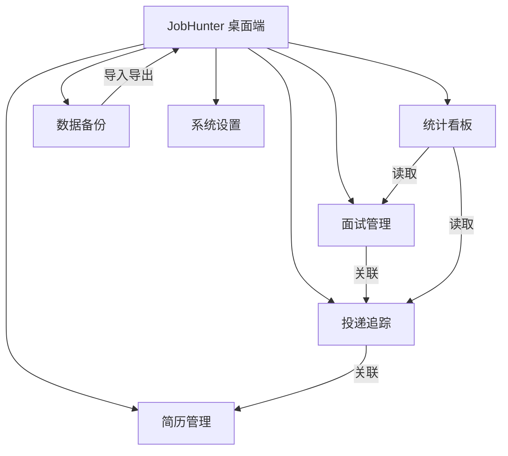
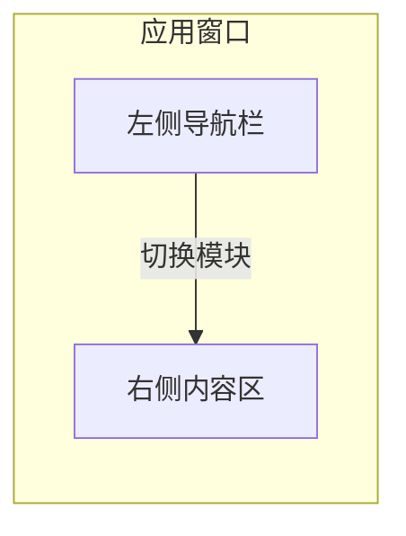

# 求职进度与简历管理工具（JobHunter）产品需求文档

| 项目 | 内容 |
| --- | --- |
| 文档版本 | V1.0 |
| 产品名称 | JobHunter（求职进度与简历管理工具） |
| 文档状态 | 待评审 |
| 目标版本 | MVP（最小可行版本） |
| 适用平台 | Windows / macOS 桌面端（全本地存储，离线可用） |

---

## 1. 项目背景与产品目标

### 1.1 项目背景

应届大学生求职（秋招/春招）具有明显的集中性和多线程特征：一名学生往往在 2-3 个月内向数十家甚至上百家企业投递简历，同时并行推进多场笔试与面试。当前大部分学生使用 Excel、备忘录或纸质笔记来记录求职进度，存在以下问题：

1. **信息分散**：简历文件、投递记录、面试安排散落在不同工具中，难以统一管理。
2. **状态混乱**：缺少统一的投递状态流转，容易遗忘已投递的公司、遗漏后续流程。
3. **缺少复盘**：无法快速统计"投了多少、面了几家、通过率多少"，难以优化求职策略。
4. **数据丢失风险**：本地零散记录易误删、难备份，一旦丢失无法恢复。

市场上现有的求职管理工具多为联网 SaaS 或移动端 App，对注重数据隐私、希望在本地离线管理的应届生并不友好。

### 1.2 产品定位

JobHunter 是一款**面向应届大学生的本地桌面端求职管理工具**，将简历生成、投递追踪、面试管理、求职统计、数据备份五大功能整合于一体，全程本地存储、无需联网。功能完整度显著高于单一场景的电子阅读器（后者仅需阅读与笔记，本产品需覆盖多模块数据管理、结构化录入、统计分析与数据迁移）。

### 1.3 产品目标

1. 让用户在一个应用内完成"写简历 → 记录投递 → 管理面试 → 查看统计 → 备份数据"的完整求职闭环。
2. 降低求职信息管理的心理负担，避免因遗漏投递/面试而错失机会。
3. 提供数据安全感：全本地存储 + 一键备份，用户可随时导出/恢复。

### 1.4 成功指标（KPI，MVP 验收参考）

- 单用户可在 10 分钟内完成首份简历创建并导出 PDF。
- 单用户可稳定维护 50+ 条投递记录且操作无明显卡顿。
- 统计看板能在 1 秒内完成当前数据集的聚合展示。
- 备份/恢复流程可在 3 步内完成，恢复后数据完整无损。

---

## 2. 目标用户画像与典型使用场景

### 2.1 用户画像

**画像 A：海投型应届生（大三/大四）**
- 特点：求职方向尚不明确，采用"广撒网"策略，投递量大。
- 诉求：快速记录投递、避免重复投递或遗忘跟进、批量管理状态。

**画像 B：目标明确型求职者**
- 特点：有清晰的目标行业/岗位，注重简历定制与面试质量。
- 诉求：针对不同岗位维护多份简历、精细管理面试安排与复盘。

**画像 C：易焦虑/易遗漏型求职者**
- 特点：流程一多容易乱，依赖提醒和清晰的状态看板。
- 诉求：一眼看清当前"待处理/待面试"事项，数据随时可备份以防丢失。

### 2.2 三个典型使用场景

**场景一：海投期的高效记录与跟进**
> 用户小王在秋招季每天向 5-8 家公司投递。他打开 JobHunter，在"投递追踪"中新建记录，选择已准备好的简历版本，填写公司、岗位、渠道与投递日期。当晚他在列表视图中按"待笔试"状态筛选，快速核对今天投了哪些、哪些需要明天跟进。

**场景二：多场面试的并行管理**
> 用户小李同时收到 3 家公司面试邀请。她在"面试管理"中为每场面试关联对应投递、填写时间与形式（线上/线下），并在准备清单中记录需复习的内容。面试结束后，她记录面试问题与复盘，并将结果同步回投递状态（通过/待定/未通过）。

**场景三：秋招结束后的复盘与数据备份**
> 秋招结束后，用户小张打开"统计看板"，查看投递总数、各状态占比、渠道转化率与"投递→面试→Offer"漏斗。确认数据无误后，他使用"数据备份"导出一份备份文件保存到移动硬盘，为后续春招或档案留存提供依据。

---

## 3. 功能需求清单

### 3.1 功能模块总览

### 3.2 功能优先级（MoSCoW 划分）

**Must Have（MVP 必须实现）**

| 编号 | 模块 | 功能 |
| --- | --- | --- |
| M-01 | 简历管理 | 简历的创建、编辑、删除、多份简历管理 |
| M-02 | 简历管理 | 标准化简历字段（基本信息/教育/实习/项目/技能/校园经历/证书/自我评价） |
| M-03 | 简历管理 | 简历预览与 PDF 导出 |
| M-04 | 投递追踪 | 投递记录的增删改查与状态流转 |
| M-05 | 投递追踪 | 投递列表的搜索、筛选、排序 |
| M-06 | 投递追踪 | 投递与简历版本的关联 |
| M-07 | 面试管理 | 面试记录的增删改查、关联投递 |
| M-08 | 面试管理 | 面试前准备清单与面试后复盘记录 |
| M-09 | 统计看板 | 核心指标卡片与状态分布、趋势、漏斗图表 |
| M-10 | 数据备份 | 手动导出备份与导入恢复 |
| M-11 | 系统 | 数据本地持久化存储 |

**Should Have（后续迭代，MVP 后优先）**

- S-01 自动本地备份（定时/退出时备份）
- S-02 投递与面试的本地提醒（截止日期、面试前提醒）
- S-03 面试日历视图（按月/周排布）
- S-04 简历版本管理与历史回滚
- S-05 标签系统（自定义标签辅助筛选）
- S-06 深色/浅色主题切换
- S-07 投递数据导入（Excel/CSV 导入历史记录）

**Could Have（可选，视资源决定）**

- C-01 简历内容模板库（离线内置，非 AI）
- C-02 自定义简历字段与自定义状态
- C-03 统计报表导出（图表截图/PDF）
- C-04 桌面快捷键与全局搜索

**Won't Have（明确不做，边界控制）**

- W-01 云同步与账号体系（与"全本地存储"冲突）
- W-02 联网职位抓取/一键投递
- W-03 AI 简历优化/在线测评（需联网）
- W-04 多用户/团队协作
- W-05 移动端 App

### 3.3 各模块详细功能需求

> 功能编号格式：FR-{模块}-{序号}，每条含优先级（M/S/C）与验收要点。

#### 3.3.1 简历管理（FR-RES）

- **FR-RES-01（M）简历新建与多份管理**：支持创建多份简历，每份可命名（如"互联网产品-秋招"）。支持复制现有简历作为新简历起点。
- **FR-RES-02（M）标准化字段编辑**：支持结构化编辑以下字段：基本信息（姓名、电话、邮箱、求职意向、教育背景、实习经历、项目经历、技能、校园活动、证书奖项、自我评价）。字段可留空，不强制填写。
- **FR-RES-03（M）简历预览**：提供所见即所得预览，切换模板后实时刷新。
- **FR-RES-04（M）模板选择**：内置 2-3 套简洁风格模板（如"单栏经典""双栏简约"），用户可切换。
- **FR-RES-05（M）PDF 导出**：将当前简历导出为排版良好的 PDF 文件，支持选择保存路径与文件名。
- **FR-RES-06（S）版本管理**：记录简历的修改历史，可回滚到历史版本。

#### 3.3.2 投递追踪（FR-APP）

- **FR-APP-01（M）投递记录增删改查**：新建投递记录，字段包含：公司名称、岗位名称、投递日期、投递渠道（如官网/招聘平台/内推）、关联简历版本、当前状态、JD 链接、备注。
- **FR-APP-02（M）状态流转**：内置标准状态机：`已投递 → 待笔试/笔试中 → 面试中 → 已录用 / 已拒绝 / 已放弃`。状态可手动调整。
- **FR-APP-03（M）列表视图**：以表格展示投递记录，支持按公司、岗位、状态搜索，按状态/渠道/日期筛选，按投递日期排序。
- **FR-APP-04（M）关联简历**：每条投递可关联一份简历版本，便于追溯"投这家时用了哪份简历"。
- **FR-APP-05（M）编辑与删除**：支持修改、删除（含二次确认）投递记录。
- **FR-APP-06（S）本地提醒**：可为投递设置跟进提醒日期，到期通过本地通知提示。

#### 3.3.3 面试管理（FR-INT）

- **FR-INT-01（M）面试记录增删改查**：新建面试，字段包含：关联投递记录、面试时间、面试轮次（一面/二面/HR面等）、面试形式（线上/线下/电话）、地点或会议链接、面试官、备注。
- **FR-INT-02（M）时间排序视图**：以列表按面试时间升序展示，突出"即将到来"的面试。
- **FR-INT-03（M）面试前准备清单**：每条面试可维护准备事项清单，支持勾选完成。
- **FR-INT-04（M）面试后复盘**：记录面试问题、个人表现、改进点与结果。
- **FR-INT-05（M）结果回写**：面试结果可同步更新关联投递的状态（如"通过"推进到下一轮，"未通过"标记投递为"已拒绝"）。
- **FR-INT-06（S）日历视图**：按月/周查看面试安排。

#### 3.3.4 统计看板（FR-STA）

- **FR-STA-01（M）核心指标卡片**：展示投递总数、待处理数、面试总数、Offer 数。
- **FR-STA-02（M）状态分布图**：以饼图/柱状图展示当前投递状态占比。
- **FR-STA-03（M）时间趋势**：按周展示投递数、面试数变化趋势（近 8-12 周）。
- **FR-STA-04（M）渠道分析**：按投递渠道统计数量与面试转化率。
- **FR-STA-05（M）转化漏斗**：展示 `投递 → 笔试 → 面试 → Offer` 的转化漏斗。
- **FR-STA-06（S）报表导出**：将统计图表导出为图片或 PDF。

#### 3.3.5 数据备份（FR-BAK）

- **FR-BAK-01（M）手动导出备份**：一键将全部数据（简历、投递、面试、设置）导出为单个备份文件（JSON 或自定义格式），支持选择保存路径。
- **FR-BAK-02（M）导入恢复**：选择备份文件导入，恢复前展示备份概要（数据量、备份时间），确认后覆盖或合并现有数据。
- **FR-BAK-03（S）自动备份**：支持定时或应用退出时自动备份到本地指定目录。
- **FR-BAK-04（M）导出结果校验**：备份完成后校验文件可读性，导入后校验数据完整性。

#### 3.3.6 系统设置（FR-SYS）

- **FR-SYS-01（M）数据存储位置展示**：显示当前本地数据存储路径。
- **FR-SYS-02（S）主题切换**：深色/浅色主题。
- **FR-SYS-03（S）自动备份配置**：备份频率、目录、保留份数。

---

## 4. 界面设计要求

### 4.1 整体风格

- **简洁现代**：以中性色为主，低饱和强调色（如品牌蓝），留白充分，信息层级清晰。
- **轻量直观**：避免企业级系统的复杂表单与多级菜单，操作路径短、反馈及时。
- **桌面端优先**：适配窗口缩放（最小宽度约 1024px），支持窗口最大化使用。

### 4.2 布局：左侧导航 + 右侧内容

- **左侧导航栏**：纵向排列 5 个核心入口（简历管理、投递追踪、面试管理、统计看板、数据备份）与系统设置。顶部展示应用名与 Logo。
- **右侧内容区**：承载各模块页面，顶部为页面标题与主要操作按钮（如"新建投递"），下方为列表/看板/表单内容。
- **导航固定、内容滚动**：左侧导航常驻，右侧内容区独立滚动。

### 4.3 页面级设计要点

- **简历管理**：左侧简历列表 + 右侧编辑/预览区；提供"编辑 / 预览"两种模式切换。
- **投递追踪**：顶部筛选栏（搜索框 + 状态/渠道/日期筛选），中部表格，行内快捷操作。
- **面试管理**：按时间排序的面试卡片/列表，突出时间与轮次信息，附准备清单与复盘入口。
- **统计看板**：顶部指标卡片，下方图表网格，图表为简洁单色系，避免花哨动画。
- **数据备份**：清晰的两个操作入口（导出备份 / 导入恢复）与最近备份记录列表。

---

## 5. 非功能性需求

### 5.1 性能

- 常规操作（新建/编辑/切换页面）响应时间 ≤ 500ms。
- 统计看板在 1000 条投递记录规模下聚合计算 ≤ 2s。
- 应用冷启动时间 ≤ 3s。
- 简历 PDF 导出单份 ≤ 5s。
- 列表渲染支持 1000+ 条记录无卡顿（采用虚拟滚动或分页）。

### 5.2 数据安全与隐私

- **全本地存储**：所有数据仅保存在用户本机，不进行任何网络上传（可声明离线可用）。
- **备份完整性**：导出备份文件应包含全部数据；导入后校验数据条数与关键字段完整。
- **误操作保护**：删除投递/面试/简历等破坏性操作提供二次确认。
- **数据损坏防护**：写入采用原子化/事务方式，避免异常退出导致数据损坏；必要时保留自动备份。

### 5.3 兼容性

- 支持 Windows 10/11 与 macOS 11+ 桌面系统。
- 支持常见中文输入与中文简历内容排版（PDF 导出中文不出现乱码）。
- 支持 100% / 125% / 150% 显示缩放下的界面清晰显示。

### 5.4 可用性与可靠性

- 关键功能首次使用提供轻量引导（如空状态提示下一步操作）。
- 异常（如备份文件损坏）需给出明确中文提示，不崩溃。
- 核心流程（新建投递、导出备份）操作步骤 ≤ 3 步。

---

## 6. MVP 版本验收标准

> 以下为 MVP 上线前必须全部通过的验收项。

**简历管理**
1. 能创建、编辑、删除多份简历，字段录入与保存正常。
2. 能在 2-3 套模板间切换并实时预览。
3. 能成功导出中文排版正确的 PDF 文件。

**投递追踪**
4. 能新建投递记录并关联简历版本，字段保存完整。
5. 状态流转（已投递→笔试→面试→录用/拒绝/放弃）操作正确。
6. 列表支持搜索、筛选、排序，50 条记录下操作流畅。

**面试管理**
7. 能新建面试并关联投递，时间、轮次、形式信息保存正确。
8. 准备清单可勾选，复盘内容可记录并保存。
9. 面试结果可正确回写关联投递的状态。

**统计看板**
10. 指标卡片（投递/待处理/面试/Offer）数值准确。
11. 状态分布、趋势、渠道、漏斗图表能基于真实数据正确渲染。

**数据备份**
12. 导出备份文件后，能通过导入完整恢复全部数据（简历、投递、面试、设置）。
13. 导入前能预览备份概要，导入后数据条数与内容一致。

**整体**
14. 全程离线可用，无任何网络请求。
15. 破坏性操作（删除、覆盖恢复）均有二次确认。

---

## 7. 约束与风险说明

### 7.1 约束

- **技术约束**：需在桌面端实现离线本地存储与 PDF 生成；不引入后端服务。
- **范围约束**：MVP 聚焦 5 大核心模块，AI、云同步、联网功能明确不在范围内。
- **数据格式约束**：备份文件需保证跨版本可恢复的兼容性。

### 7.2 风险与应对

| 风险 | 影响 | 应对措施 |
| --- | --- | --- |
| 本地数据丢失（误删/磁盘损坏） | 用户求职数据丢失 | 提供一键备份、自动备份、二次确认，备份文件可迁移 |
| PDF 中文排版乱码/格式错乱 | 简历导出体验差 | MVP 前重点测试中文与多模板导出，必要时引入成熟排版方案 |
| 功能范围蔓延（想加联网/AI） | 工期与复杂度失控 | 严格遵循 MoSCoW 边界，Won't Have 项明确不做 |
| 大量记录性能下降 | 使用卡顿 | 列表虚拟滚动 + 统计聚合优化，设定 1000 条性能目标 |
| 备份文件版本不兼容 | 旧备份无法恢复 | 备份文件内置版本号，导入时做兼容处理或提示升级 |
