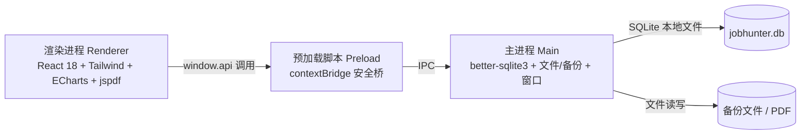
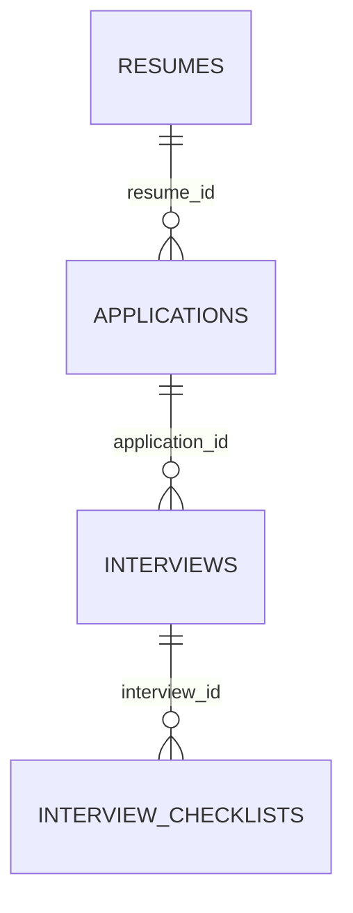

# JobHunter 技术设计文档

| 项目 | 内容 |
| --- | --- |
| 文档版本 | V1.0 |
| 技术栈 | Electron + React 18 + TypeScript + Vite + Tailwind CSS + better-sqlite3 + jspdf + html2canvas + ECharts + electron-builder |
| 目标版本 | MVP |
| 对应 PRD | 《求职进度与简历管理工具（JobHunter）产品需求文档》 |

---

## 1. 技术栈选型说明与选型理由

### 1.1 整体架构

采用 Electron 标准三进程架构：**主进程（Main）** 负责数据存储与系统能力，**渲染进程（Renderer）** 负责 UI 交互，二者通过 **预加载脚本（Preload）** 暴露的安全 API 桥接，遵循 `contextIsolation: true`、`nodeIntegration: false` 的安全基线。



### 1.2 选型理由

| 技术 | 选型理由 |
| --- | --- |
| **Electron** | 跨 Windows/macOS 桌面框架，可用 Web 技术栈构建桌面端，天然支持全本地存储与离线运行，契合团队 React 技术背景 |
| **React 18** | 组件化 UI 生态成熟，并发特性与 `useTransition` 等可优化大数据量交互，适合中大型界面 |
| **TypeScript** | 类型安全，尤其用于定义多进程 IPC 契约与数据模型，显著降低运行时错误与联调成本 |
| **Vite** | 冷启动与 HMR 极快，原生 ESM；配合 `electron-vite` 可统一构建 main/preload/renderer 三进程 |
| **Tailwind CSS** | 原子化 CSS，快速实现 PRD 要求的"简洁现代"风格，保证设计一致性，避免维护庞大样式文件 |
| **better-sqlite3** | 嵌入式 SQLite 驱动，**同步 API 简单**、性能高、支持事务与 WAL；面向千级记录的单机数据量完全够用，且比 node-sqlite3 更易用 |
| **jspdf + html2canvas** | 纯 JS 方案、无原生依赖；html2canvas 将简历预览 DOM 转图片后写入 PDF，实现"所见即所得"导出，避免手写 PDF 布局 |
| **ECharts** | 开箱即用的图表库，原生支持饼图/柱状图/漏斗/趋势，契合统计看板需求；可按需引入控制打包体积 |
| **electron-builder** | 成熟的打包工具，支持 Win/macOS 安装包，内建原生依赖重编译（`install-app-deps`）能力 |

### 1.3 补充说明（唯一额外构建依赖）

为整合 Vite 与 Electron 三进程构建，引入 **`electron-vite`** 作为唯一额外**开发期构建工具**（不属于业务库，仅替代手写多份 Vite 配置），并配套使用其 `externalizeDepsPlugin` 处理原生模块外部化。业务运行时依赖严格限定在上述强制清单内，不引入任何其他库。

---

## 2. 项目目录结构

```
job-hunter-desktop/
├── package.json                 # 依赖、脚本（dev/build/package）、postinstall 重编译
├── electron.vite.config.ts      # electron-vite 三进程构建配置（main/preload/renderer）
├── electron-builder.yml         # electron-builder 打包配置（asarUnpack、install-app-deps、平台产物）
├── tsconfig.json                # 根 TS 配置（引用下面两个子配置）
├── tsconfig.node.json           # main/preload 进程 TS 配置
├── tsconfig.web.json            # renderer 进程 TS 配置
├── tailwind.config.js           # Tailwind 主题、内容扫描路径
├── postcss.config.js            # PostCSS（Tailwind 依赖）
├── .gitignore
├── resources/                   # 应用图标等打包资源
└── src/
    ├── shared/                  # 主/渲染进程共享的纯类型与常量（无运行时代码，避免跨进程污染）
    │   ├── types.ts             # 领域类型：Resume/Application/Interview/StatsResult 等
    │   ├── constants.ts         # 枚举：投递状态、渠道、面试轮次、简历模板标识
    │   └── ipc-channels.ts      # 所有 IPC 通道名与请求/响应类型契约
    │
    ├── main/                    # Electron 主进程
    │   ├── index.ts             # 主进程入口：创建 BrowserWindow、注册 IPC、初始化 DB
    │   ├── window.ts            # 窗口创建与生命周期（尺寸、安全配置）
    │   ├── db/
    │   │   ├── index.ts         # better-sqlite3 连接初始化（WAL 模式、外键开启）
    │   │   ├── schema.sql       # 建表 SQL（含索引）
    │   │   ├── migrations.ts    # 基于 PRAGMA user_version 的迁移执行器
    │   │   └── repositories/    # 数据访问层（封装 SQL，返回领域对象）
    │   │       ├── resume.repo.ts
    │   │       ├── application.repo.ts
    │   │       ├── interview.repo.ts
    │   │       ├── stats.repo.ts     # 聚合查询（统计看板用）
    │   │       └── settings.repo.ts
    │   ├── service/             # 业务逻辑层（校验、状态流转、跨表事务）
    │   │   ├── resume.service.ts
    │   │   ├── application.service.ts
    │   │   ├── interview.service.ts
    │   │   └── stats.service.ts
    │   ├── ipc/
    │   │   ├── index.ts         # 统一注册所有 handler
    │   │   ├── resume.handler.ts
    │   │   ├── application.handler.ts
    │   │   ├── interview.handler.ts
    │   │   ├── stats.handler.ts
    │   │   └── backup.handler.ts
    │   ├── backup/
    │   │   └── backup.service.ts# 备份导出/导入（事务读取/恢复、版本校验）
    │   └── file/
    │       └── file.service.ts  # 保存对话框 + 文件写入（PDF/备份落盘）
    │
    ├── preload/
    │   └── index.ts             # contextBridge 暴露 window.api（白名单，仅暴露必要方法）
    │
    └── renderer/                # 渲染进程（React 应用）
        ├── index.html
        └── src/
            ├── main.tsx         # React 挂载入口
            ├── App.tsx          # 路由与全局 Provider
            ├── router/
            │   └── index.tsx    # 页面路由表（5 大模块 + 设置）
            ├── layouts/
            │   └── AppLayout.tsx# 左侧导航 + 右侧内容 的主布局
            ├── pages/
            │   ├── ResumePage/       # 简历管理：列表 + 编辑/预览
            │   ├── ApplicationsPage/ # 投递追踪：表格 + 筛选
            │   ├── InterviewsPage/   # 面试管理：时间排序列表 + 清单/复盘
            │   ├── DashboardPage/    # 统计看板：指标卡 + ECharts
            │   ├── BackupPage/       # 数据备份：导出/导入 + 记录
            │   └── SettingsPage/     # 系统设置
            ├── components/       # 通用组件（Modal/Confirm/表单控件/状态标签）
            ├── hooks/            # useApplications/useResumes 等数据 hooks
            ├── lib/
            │   ├── api.ts        # 封装 window.api 的类型化调用层
            │   ├── echarts.ts    # ECharts 按需注册与实例管理
            │   └── format.ts     # 日期/文案格式化
            ├── pdf/
            │   └── resumePdf.ts  # jspdf + html2canvas 生成简历 PDF
            ├── styles/
            │   └── globals.css   # Tailwind 指令 + 全局样式
            └── assets/
```

---

## 3. 数据模型设计

### 3.1 设计原则

- 采用 **SQLite（better-sqlite3）** 单文件数据库，存储于用户数据目录。
- **投递、面试** 属于"记录型"数据，需频繁查询/筛选/聚合，故**规范化成表**。
- **简历内容** 属于"文档型"数据，字段异构、嵌套且仅以整体为单位编辑，故以 **JSON 列** 存储，避免过度拆表（符合 PRD"不设计企业级复杂功能"的约束）。

### 3.2 表关系（ER）



### 3.3 表结构明细

#### 表 1：`resumes`（简历表）

| 字段 | 类型 | 说明 |
| --- | --- | --- |
| `id` | INTEGER | 主键，自增 |
| `name` | TEXT | 简历名称（如"互联网产品-秋招"），非空 |
| `template_id` | TEXT | 模板标识（`classic` / `two-column`），非空 |
| `content` | TEXT | 简历结构化内容，JSON 字符串（schema 见下） |
| `created_at` | TEXT | 创建时间（ISO8601） |
| `updated_at` | TEXT | 更新时间（ISO8601） |

`content` JSON 结构：

```json
{
  "basic": { "name": "", "phone": "", "email": "", "jobIntention": "", "summary": "" },
  "educations":  [ { "school": "", "major": "", "degree": "", "start": "", "end": "", "gpa": "", "description": "" } ],
  "experiences": [ { "company": "", "position": "", "start": "", "end": "", "description": "" } ],
  "projects":    [ { "name": "", "role": "", "start": "", "end": "", "description": "" } ],
  "skills":      [ { "name": "", "level": "" } ],
  "activities":  [ { "name": "", "role": "", "start": "", "end": "", "description": "" } ],
  "certificates":[ { "name": "", "date": "", "description": "" } ],
  "selfEvaluation": ""
}
```

#### 表 2：`applications`（投递记录表）

| 字段 | 类型 | 说明 |
| --- | --- | --- |
| `id` | INTEGER | 主键，自增 |
| `company` | TEXT | 公司名称，非空 |
| `position` | TEXT | 岗位名称，非空 |
| `applied_date` | TEXT | 投递日期（YYYY-MM-DD） |
| `channel` | TEXT | 投递渠道（官网/招聘平台/内推） |
| `resume_id` | INTEGER | 关联简历，外键 → `resumes.id`（可空，`ON DELETE SET NULL`） |
| `status` | TEXT | 状态：`applied`/`written_test`/`interviewing`/`offered`/`rejected`/`withdrawn` |
| `jd_link` | TEXT | JD 链接 |
| `note` | TEXT | 备注 |
| `created_at` | TEXT | 创建时间 |
| `updated_at` | TEXT | 更新时间 |

索引：`idx_app_status`（status）、`idx_app_date`（applied_date）、`idx_app_resume`（resume_id）。

#### 表 3：`interviews`（面试记录表）

| 字段 | 类型 | 说明 |
| --- | --- | --- |
| `id` | INTEGER | 主键，自增 |
| `application_id` | INTEGER | 关联投递，外键 → `applications.id`（非空，`ON DELETE CASCADE`） |
| `round` | TEXT | 面试轮次（一面/二面/HR面） |
| `type` | TEXT | 面试形式（线上/线下/电话） |
| `scheduled_at` | TEXT | 面试时间（ISO8601） |
| `location` | TEXT | 地点或会议链接 |
| `interviewer` | TEXT | 面试官 |
| `note` | TEXT | 备注 |
| `result` | TEXT | 结果：`pending`/`passed`/`failed` |
| `review` | TEXT | 面试后复盘（问题/表现/改进点） |
| `created_at` | TEXT | 创建时间 |
| `updated_at` | TEXT | 更新时间 |

索引：`idx_int_app`（application_id）、`idx_int_time`（scheduled_at）。

#### 表 4：`interview_checklists`（面试准备清单项）

| 字段 | 类型 | 说明 |
| --- | --- | --- |
| `id` | INTEGER | 主键，自增 |
| `interview_id` | INTEGER | 关联面试，外键 → `interviews.id`（非空，`ON DELETE CASCADE`） |
| `content` | TEXT | 准备事项内容，非空 |
| `done` | INTEGER | 是否完成（0/1，默认 0） |
| `sort_order` | INTEGER | 排序序号 |

#### 表 5：`settings`（系统设置，键值对）

| 字段 | 类型 | 说明 |
| --- | --- | --- |
| `key` | TEXT | 主键 |
| `value` | TEXT | 值（JSON 或字符串） |

预置键：`theme`、`auto_backup_enabled`、`auto_backup_dir`、`auto_backup_frequency`、`auto_backup_keep_count`、`data_version`。

#### 表 6：`backup_history`（备份记录）

| 字段 | 类型 | 说明 |
| --- | --- | --- |
| `id` | INTEGER | 主键，自增 |
| `backup_path` | TEXT | 备份文件绝对路径 |
| `backup_at` | TEXT | 备份时间 |
| `type` | TEXT | 类型：`manual`/`auto` |
| `data_count` | INTEGER | 备份时投递+面试数据条数 |
| `size` | INTEGER | 文件大小（字节） |

### 3.4 关联关系汇总

- `resumes` 1 ─ N `applications`（一份简历可对应多条投递；删除简历时投递记录保留、`resume_id` 置空）。
- `applications` 1 ─ N `interviews`（一条投递可有多轮面试；删除投递时级联删除其面试）。
- `interviews` 1 ─ N `interview_checklists`（一场面试有多条准备事项；级联删除）。
- `settings` 与 `backup_history` 为独立辅助表，不参与业务外键。

---

## 4. 关键技术难点与对应解决方案

### 4.1 better-sqlite3 原生模块与 Electron/Vite 集成

- **难点**：better-sqlite3 是 C++ 原生模块，必须运行在主进程，且需针对 Electron 的 ABI 重新编译；Vite 打包时不能将其打进 bundle。
- **方案**：
  1. 用 `electron-vite` 的 `externalizeDepsPlugin` 将 better-sqlite3 标记为外部依赖，不参与打包。
  2. 在 `package.json` 的 `postinstall` 中执行 `electron-builder install-app-deps`，针对 Electron 版本自动重编译原生模块。
  3. 仅在 `main/db/index.ts` 中引入，绝不导入到 renderer。

### 4.2 多进程安全与类型化 IPC

- **难点**：默认开启 Node 会带来安全风险；同时跨进程调用容易出现通道名拼写错误、参数类型不一致。
- **方案**：
  1. BrowserWindow 设置 `contextIsolation: true`、`nodeIntegration: false`、`sandbox` 按需开启。
  2. Preload 用 `contextBridge.exposeInMainWorld` 仅暴露白名单方法。
  3. 所有通道名与请求/响应类型集中在 `shared/ipc-channels.ts`，渲染层通过 `lib/api.ts` 做类型化封装，从类型层面杜绝拼写与类型错误。

### 4.3 PDF 中文排版与跨页分页

- **难点**：html2canvas 直接截图会导致文字栅格化、跨页时内容被截断、中文字体渲染不一致。
- **方案**：
  1. 简历预览容器渲染为固定 A4 宽度（如 794px），用 CSS 控制布局稳定。
  2. 导出时用 html2canvas 以高 `scale`（如 2）截图，按元素 Y 坐标切分为多张"页图"，避免在文字中间截断。
  3. jspdf 创建 A4 页面（210×297mm），逐页 `addImage`。
  4. 中文依赖浏览器系统字体渲染（html2canvas 输出为位图），从根上规避 jspdf 字体嵌入的中文问题。

### 4.4 统计看板大数据量性能

- **难点**：千级记录下，若在渲染层全量取数再聚合，会出现卡顿。
- **方案**：
  1. 聚合计算下沉到 SQL（`stats.repo.ts` 使用 `GROUP BY`/`COUNT`/`SUM`），renderer 只接收聚合结果。
  2. 投递列表采用**分页 + 索引查询**（MVP 1000 条规模足够），不引入额外虚拟滚动库。
  3. ECharts 按需注册（`lib/echarts.ts`）降低首包体积，组件懒加载。

### 4.5 数据备份与恢复的完整性与兼容性

- **难点**：备份需原子性、跨版本可恢复、导入前需校验与防误覆盖。
- **方案**：
  1. 备份文件为带版本号的 JSON：`{ schema_version, backup_at, tables: { resumes: [], applications: [], ... } }`。
  2. 导出时在单个事务/快照内读取，保证一致性；导入时先解析并校验 `schema_version`，不匹配时提示。
  3. 恢复采用"覆盖式"导入，且在覆盖前**自动对当前数据做一次临时备份**作为安全网；恢复结果校验数据条数。

### 4.6 数据库迁移与版本升级

- **难点**：应用迭代时表结构会变化，需平滑升级老用户数据。
- **方案**：用 SQLite `PRAGMA user_version` 记录 schema 版本；`migrations.ts` 按版本号顺序执行增量迁移脚本，首次启动时从 `schema.sql` 建库并把 `user_version` 置为最新。

### 4.7 打包与原生依赖体积

- **难点**：electron-builder 打包时需正确处理 `.node` 原生文件与多平台差异。
- **方案**：在 `electron-builder.yml` 中配置 `asarUnpack` 包含 `**/*.node`，配合 `install-app-deps` 重编译；分别配置 Windows（NSIS）与 macOS（dmg/zip）产物。

---

## 5. 开发阶段划分与推荐实施顺序

> 按"基础设施 → 核心闭环 → 辅助模块 → 收尾"推进，每个阶段可独立验证。

**阶段 0：脚手架与基础设施（1-2 天）**
- 初始化 electron-vite + React 18 + TS + Tailwind 工程。
- 配置 electron-builder 与 better-sqlite3 重编译，跑通 `dev` 与一次 `package` 冒烟。
- 搭建三进程骨架、preload 安全桥、`shared` 类型/常量/IPC 通道。
- 验收：空应用可启动，主/渲染进程 IPC 可往返。

**阶段 1：数据层与通用组件（2-3 天）**
- 完成 `schema.sql`、`migrations.ts`、各 `repositories`。
- 完成通用组件（Modal、Confirm、表单控件、状态标签）。
- 完成系统设置页骨架。
- 验收：可对每张表做 CRUD，数据落盘并持久化。

**阶段 2：简历管理模块（3-4 天，最优先）**
- 简历 CRUD + 表单 + 预览 + 模板切换。
- `resumePdf.ts` 实现 jspdf + html2canvas 导出 PDF。
- 验收：能创建多份简历并导出中文正确的 PDF（其他模块依赖简历关联）。

**阶段 3：投递追踪模块（2-3 天）**
- 投递 CRUD、状态流转、列表搜索/筛选/排序、关联简历。
- 验收：50+ 条记录操作流畅，状态流转正确。

**阶段 4：面试管理模块（2-3 天）**
- 面试 CRUD、准备清单、复盘、结果回写投递状态。
- 验收：面试结果能正确联动投递状态。

**阶段 5：统计看板模块（2-3 天）**
- `stats.repo.ts` 聚合查询 + ECharts 指标卡/分布/趋势/渠道/漏斗。
- 验收：图表基于真实数据正确渲染，千级记录聚合 ≤ 2s。

**阶段 6：数据备份模块（1-2 天）**
- `backup.service.ts` 导出/导入、备份记录、恢复前校验与安全网。
- 验收：导出后导入可完整恢复全部数据。

**阶段 7：收尾与发布（2-3 天）**
- 性能与兼容性测试（缩放、中文、1000 条记录）、验收标准核对。
- electron-builder 产出 Windows/macOS 安装包。
